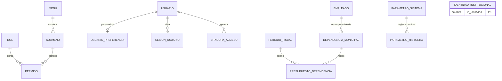

# Plan de desarrollo — Módulo de Configuración (Gestión Administrativa)

**Proyecto:** Sistema Web para la Gestión de la Cadena de Suministro de Proveedores — Municipalidad de Panajachel
**Fuentes:** DERCAS (27/07/2026), Tesis Final, prototipo (pantalla "Configuración del Sistema" y sus pestañas) y los planes de los demás módulos
**Metodología:** Scrum por sprints, arquitectura MVC

> Convención: lo marcado como **(propuesta)** es una recomendación mía que los documentos no mencionan. Queda a tu decisión.

---

## 1. Objetivo y alcance

**Qué dicen los documentos.** El DERCAS y la tesis definen el "Módulo de Configuración" como el que *permite parametrizar el comportamiento global de la plataforma, administrando perfiles de usuario, el catálogo de dependencias municipales, el período fiscal activo y la identidad visual institucional*. En el DERCAS, el Soporte Técnico es el grupo responsable de la "configuración de la plataforma".

**Qué muestra el prototipo.** La pantalla "Configuración del Sistema" ("gestión de preferencias de interfaz, seguridad y parámetros administrativos") tiene cinco pestañas: **Apariencia y Tema, Perfil de Usuario, Notificaciones, Seguridad y Accesos y Auditoría**. Todas son preferencias personales o de seguridad. **Ninguna** cubre las dependencias, el período fiscal ni la identidad institucional que pide la definición del módulo.

**Qué hace este plan.** Cubre las dos cosas: las cinco pestañas del prototipo y los elementos de la definición, agregados como pestañas administrativas (sección 4).

**Dentro del alcance**

- Preferencias personales: tema oscuro, interfaz compacta, animaciones, color de acento, idioma y zona horaria.
- Perfil propio (con foto), notificaciones, cambio de clave y sesiones abiertas.
- Seguridad y accesos: roles y permisos, y políticas de contraseña y sesión.
- Identidad visual institucional.
- Catálogo de dependencias municipales, período fiscal activo y presupuesto por dependencia.
- Catálogos de apoyo y parámetros del sistema que usan los demás módulos.
- Auditoría: consulta y exportación a CSV del registro de actividad.
- Ventana de confirmación de cierre de sesión.

**Fuera del alcance**

- Alta, edición y desactivación de **usuarios**: es el módulo "Usuarios" (opción propia del menú). Configuración solo consume sus servicios.
- La **configuración del Portal del Proveedor** (modo oscuro, contacto y clave del proveedor): se define en el plan de integración y comparte el servicio de preferencias.
- Respaldos de la base de datos y configuración del servidor: no están en los documentos.

## 2. Dependencias y relación con otros módulos

| Módulo | Relación |
|---|---|
| **Usuarios** | Dueño de `usuario`, `empleado`, `rol`, `menu`, `submenu`, `permiso` y de los servicios de autenticación y bitácora. Configuración reutiliza su API de roles y permisos y su bitácora; **no los reimplementa** |
| **Dependencias** | Dueño de `periodo_fiscal` y `presupuesto_dependencia`. Configuración es la **pantalla** donde se administran |
| **Facturación, Proveedores, Bodega, Proformas** | Consumen los catálogos y parámetros que se administran aquí (sección 8) |
| **Dashboard, Reportes y Portal** | Leen identidad, preferencias, zona horaria y período activo |

**Regla de propiedad.** Configuración es el **dueño** de `identidad_institucional`, `parametro_sistema`, `parametro_historial`, `sesion_usuario`, `dia_inhabil` y de `usuario_preferencia`. Para los catálogos que pertenecen a otros módulos (dependencias, tipos de proveedor, partidas, etc.), Configuración ofrece la pantalla y llama a los servicios del dueño.

## 3. Stack tecnológico (según los documentos)

| Capa | Tecnología |
|---|---|
| Frontend | React, HTML5, CSS3 (temas, animaciones y estilos modulares por componente, como indica el DERCAS) |
| Backend | Node.js, API REST con JSON |
| Base de datos | PostgreSQL 15+ |
| Despliegue | Docker, Microsoft Azure; el diagrama muestra Railway con SSL/TLS |
| Versiones y pruebas | Git, GitHub, Postman |

**Complementos sugeridos (propuesta):** `multer` y `sharp` para validar y reducir imágenes (logo, foto), `zod`, `bcrypt` y `jsonwebtoken` (ya usados en Usuarios), `react-i18next` para el idioma, `json2csv` para exportar, `Jest` + `Supertest`.

## 4. Estructura de la pantalla

El prototipo usa pestañas horizontales. Con siete pestañas conviene agruparlas en **"Mi cuenta"** (visibles para todo usuario interno) y **"Administración"** (según permisos). El menú lateral sigue mostrando una sola opción: "Configuración".

| Pestaña | Origen | Quién la ve | Contenido |
|---|---|---|---|
| **Apariencia y Tema** | Prototipo | Todos | Modo oscuro, interfaz compacta, animaciones, color de acento, idioma y zona horaria |
| **Perfil de Usuario** | Prototipo | Todos | Foto, nombre, cargo, correo, extensión y teléfono |
| **Notificaciones** | Prototipo | Todos | Canales (correo, sistema) y alertas de vencimiento |
| **Seguridad y Accesos** | Prototipo, ampliada | Todos (cuenta propia) y Administración | *Mi cuenta:* cambiar clave y sesiones abiertas. *Administración:* roles y permisos, políticas de seguridad |
| **Institucional** | DERCAS | Administración | Identidad visual institucional y catálogo de dependencias |
| **Período Fiscal y Presupuesto** | DERCAS | Administración y DAFIM | Períodos, período activo y presupuesto por dependencia |
| **Catálogos y Parámetros** | Propuesta | Administración | Catálogos de apoyo, días inhábiles y parámetros del sistema |
| **Auditoría** | Prototipo | Administración | Registro de actividad del sistema con exportación a CSV |

**Acceso a las pestañas (propuesta).** Las pestañas de "Mi cuenta" no usan RBAC: las ve cualquier usuario autenticado de gestión administrativa, y solo afectan a su propia cuenta. Las de "Administración" se controlan con `PERMISO` por submenú (sección 5.5).

### 4.1 Diferencias entre las fuentes

| # | Situación | Criterio del plan |
|---|---|---|
| C-1 | El DERCAS define cuatro elementos (perfiles, dependencias, período fiscal, identidad); el prototipo no tiene pestañas para tres de ellos. | Se agregan las pestañas "Institucional", "Período Fiscal y Presupuesto" y "Catálogos y Parámetros". |
| C-2 | "Perfiles de usuario": el glosario del DERCAS dice que un perfil es una *configuración de seguridad que asigna permisos y restricciones*; el prototipo llama "Perfil de Usuario" a los datos personales. | Se cubren ambos: los **perfiles de seguridad** (roles y permisos) en "Seguridad y Accesos", y los **datos personales** en "Perfil de Usuario". |
| C-3 | El DERCAS describe "Gestión de Usuarios y Accesos" como otro módulo, que también administra roles y permisos. | Los roles y permisos los implementa Usuarios; Configuración muestra esa pantalla dentro de su pestaña. |
| C-4 | En el ER, `BITACORA_ACCESO.idUsuario` es obligatorio, pero el prototipo muestra "Intento de acceso denegado — *Usuario desconocido*". | `id_usuario` pasa a ser opcional y se guarda el nombre de usuario intentado. |
| C-5 | El prototipo muestra nombre, cargo y correo como campos editables, y una **extensión** que no existe en el ER. | Nombre y cargo vienen de `empleado` y `puesto` y se muestran en solo lectura (D-4). Se agrega `empleado.extension`. |
| C-6 | La tarjeta "Alertas de Vencimiento" dice "48 y 24 horas antes". El flujo de pagos definido después usa recordatorios a **3 y 1 días hábiles**. | El texto de la pantalla se toma de los parámetros `RECORDATORIO_PAGO_1` y `_2`, no se escribe fijo. |
| C-7 | `PERMISO` del ER solo relaciona rol y submenú. La matriz de roles del plan de integración usa acciones (ver, crear, aprobar, exportar). | Se agregan columnas de acción a `permiso` (D-7). |
| C-8 | El reporte "Gastos por departamento" del prototipo muestra un **responsable** por dependencia; `DEPENDENCIA_MUNICIPAL` no lo tiene. | Se agrega `id_empleado_responsable`. |

## 5. Modelo de datos

### 5.1 Qué existe y qué se agrega

| Entidad | Creada en | Cambio en este plan |
|---|---|---|
| `dependencia_municipal` | Usuarios (001) y Dependencias (020: `siglas`) | + `id_empleado_responsable` |
| `empleado` | Usuarios (001) | + `extension` |
| `rol`, `menu`, `submenu`, `permiso` | Usuarios (001) | `permiso` + columnas de acción; semillas del menú "Configuración" |
| `bitacora_acceso` | Usuarios (001) y Integración (060) | `id_usuario` opcional, + `resultado`, + `nombre_usuario_intento`, inmutable |
| `usuario_preferencia` | Integración (060) | + foto |
| `periodo_fiscal`, `presupuesto_dependencia` | Dependencias (020) | `periodo_fiscal` + fechas y cierre |
| `parametro_sistema`, `dia_inhabil` | Flujo Bodega central (070) | `parametro_sistema` + tipo, rango, grupo; catálogo completo de parámetros |
| `tipo_proveedor`, `categoria`, `unidad_medida`, `partida_presupuestaria`, `fuente_financiamiento`, `puesto` | Proveedores, catálogo de insumos, Facturación, Usuarios | Sin cambios; se administran desde aquí |
| `identidad_institucional` | **Nueva** | Una sola fila |
| `parametro_historial` | **Nueva** | Cambios de parámetros |
| `sesion_usuario` | **Nueva** | Sesiones abiertas y cierre remoto |

### 5.2 Relaciones



### 5.3 Migración PostgreSQL

Este script se ejecuta **después** de las migraciones de los demás módulos (001 a 070).

```sql
-- 080_configuracion.sql  (PostgreSQL 15+)

-- 1) Identidad visual institucional (una sola fila)
CREATE TABLE identidad_institucional (
  id_identidad         SMALLINT PRIMARY KEY DEFAULT 1 CHECK (id_identidad = 1),
  nombre_institucion   VARCHAR(120) NOT NULL DEFAULT 'Municipalidad de Panajachel',
  nombre_corto         VARCHAR(40)  NOT NULL DEFAULT 'Muni Panajachel',
  nombre_sistema       VARCHAR(120) NOT NULL DEFAULT 'Sistema de Gestión Municipal y Cadena de Suministros',
  subtitulo_gestion    VARCHAR(60)  NOT NULL DEFAULT 'Gestión Administrativa',
  subtitulo_portal     VARCHAR(60)  NOT NULL DEFAULT 'Portal de Proveedores',
  lema                 VARCHAR(150),
  nit_institucional    VARCHAR(15),
  direccion            VARCHAR(200),
  telefono             VARCHAR(20),
  correo_contacto      VARCHAR(100),
  color_principal      VARCHAR(7) NOT NULL DEFAULT '#1B5E30'
                       CHECK (color_principal ~ '^#[0-9A-Fa-f]{6}$'),
  colores_acento       VARCHAR(100) NOT NULL
                       DEFAULT '#1B5E30,#1D4ED8,#7C3AED,#B45309,#0F766E,#BE123C',  -- valores de ejemplo
  logo                 BYTEA,
  logo_mime            VARCHAR(30),
  imagen_login         BYTEA,
  imagen_login_mime    VARCHAR(30),
  fecha_actualizacion  TIMESTAMPTZ NOT NULL DEFAULT now(),
  id_usuario_actualiza INT REFERENCES usuario(id_usuario)
);
INSERT INTO identidad_institucional DEFAULT VALUES;

-- 2) Período fiscal: fechas y cierre
ALTER TABLE periodo_fiscal
  ADD COLUMN IF NOT EXISTS fecha_inicio      DATE,
  ADD COLUMN IF NOT EXISTS fecha_fin         DATE,
  ADD COLUMN IF NOT EXISTS cerrado           BOOLEAN NOT NULL DEFAULT FALSE,
  ADD COLUMN IF NOT EXISTS fecha_cierre      TIMESTAMPTZ,
  ADD COLUMN IF NOT EXISTS id_usuario_cierre INT REFERENCES usuario(id_usuario);
ALTER TABLE periodo_fiscal ADD CONSTRAINT ck_periodo_fechas
  CHECK (fecha_inicio IS NULL OR fecha_fin IS NULL OR fecha_fin >= fecha_inicio);
ALTER TABLE periodo_fiscal ADD CONSTRAINT ck_periodo_estado
  CHECK (NOT (activo AND cerrado));

-- 3) Dependencias y empleados
ALTER TABLE dependencia_municipal
  ADD COLUMN IF NOT EXISTS id_empleado_responsable INT REFERENCES empleado(id_empleado);
ALTER TABLE empleado ADD COLUMN IF NOT EXISTS extension VARCHAR(6);

-- 4) Preferencias: foto de perfil
ALTER TABLE usuario_preferencia
  ADD COLUMN IF NOT EXISTS foto                BYTEA,
  ADD COLUMN IF NOT EXISTS foto_mime           VARCHAR(30),
  ADD COLUMN IF NOT EXISTS fecha_actualizacion TIMESTAMPTZ NOT NULL DEFAULT now();

-- 5) Parámetros del sistema: metadatos para validarlos y mostrarlos
ALTER TABLE parametro_sistema
  ADD COLUMN IF NOT EXISTS grupo                VARCHAR(20) NOT NULL DEFAULT 'GENERAL',
  ADD COLUMN IF NOT EXISTS tipo                 VARCHAR(10) NOT NULL DEFAULT 'TEXTO'
         CHECK (tipo IN ('ENTERO','DECIMAL','TEXTO','BOOLEANO','LISTA')),
  ADD COLUMN IF NOT EXISTS valor_min            NUMERIC,
  ADD COLUMN IF NOT EXISTS valor_max            NUMERIC,
  ADD COLUMN IF NOT EXISTS opciones             VARCHAR(255),          -- valores separados por coma (tipo LISTA)
  ADD COLUMN IF NOT EXISTS orden                INT NOT NULL DEFAULT 0,
  ADD COLUMN IF NOT EXISTS fecha_actualizacion  TIMESTAMPTZ NOT NULL DEFAULT now(),
  ADD COLUMN IF NOT EXISTS id_usuario_actualiza INT REFERENCES usuario(id_usuario);

CREATE TABLE parametro_historial (
  id_historial   BIGINT GENERATED ALWAYS AS IDENTITY PRIMARY KEY,
  clave          VARCHAR(40) NOT NULL REFERENCES parametro_sistema(clave),
  valor_anterior VARCHAR(100),
  valor_nuevo    VARCHAR(100) NOT NULL,
  id_usuario     INT NOT NULL REFERENCES usuario(id_usuario),
  fecha          TIMESTAMPTZ NOT NULL DEFAULT now()
);

INSERT INTO parametro_sistema (clave, valor, descripcion, grupo, tipo, valor_min, valor_max, opciones, orden) VALUES
 ('CLAVE_LONGITUD_MIN',       '8',        'Longitud mínima de la clave',                                   'SEGURIDAD',   'ENTERO',   6, 32,   NULL, 1),
 ('CLAVE_COMPLEJA',           'SI',       'Exigir mayúscula, minúscula y número',                          'SEGURIDAD',   'BOOLEANO', NULL, NULL, NULL, 2),
 ('CLAVE_VIGENCIA_DIAS',      '0',        'Días de vigencia de la clave (0 = no vence)',                   'SEGURIDAD',   'ENTERO',   0, 365,  NULL, 3),
 ('INTENTOS_FALLIDOS_MAX',    '5',        'Intentos fallidos antes de bloquear la cuenta',                 'SEGURIDAD',   'ENTERO',   3, 10,   NULL, 4),
 ('BLOQUEO_MINUTOS',          '15',       'Minutos de bloqueo al exceder los intentos',                    'SEGURIDAD',   'ENTERO',   1, 1440, NULL, 5),
 ('SESION_INACTIVIDAD_MIN',   '30',       'Minutos de inactividad para cerrar la sesión',                  'SEGURIDAD',   'ENTERO',   5, 480,  NULL, 6),
 ('MIN_OFERTAS_DEFECTO',      '3',        'Mínimo de ofertas por proceso de cotización',                   'COMPRAS',     'ENTERO',   1, 10,   NULL, 1),
 ('DIAS_DUPLICIDAD_SOLICITUD','30',       'Días para advertir solicitudes repetidas del mismo ítem',       'COMPRAS',     'ENTERO',   0, 365,  NULL, 2),
 ('APROBACION_OC',            'NO',       'La orden de compra requiere aprobación antes de enviarse',      'COMPRAS',     'BOOLEANO', NULL, NULL, NULL, 3),
 ('DIAS_HABILES_PAGO',        '8',        'Días hábiles para pagar desde que se recibe la factura',        'PAGOS',       'ENTERO',   1, 60,   NULL, 1),
 ('CONTROL_RECEPCION_PAGO',   'ADVERTIR', 'Pagar sin recepción registrada',                                'PAGOS',       'LISTA',    NULL, NULL, 'NO,ADVERTIR,BLOQUEAR', 2),
 ('RECORDATORIO_PAGO_1',      '3',        'Primer recordatorio de pago, en días hábiles restantes',        'PAGOS',       'ENTERO',   1, 30,   NULL, 3),
 ('RECORDATORIO_PAGO_2',      '1',        'Segundo recordatorio de pago, en días hábiles restantes',       'PAGOS',       'ENTERO',   1, 30,   NULL, 4),
 ('TOLERANCIA_FACTURA',       '0',        'Diferencia permitida entre lo facturado y lo recibido (Q)',     'PAGOS',       'DECIMAL',  0, 1000, NULL, 5),
 ('HORAS_CONEXION_PROVEEDOR', '48',       'Horas sin acceso para mostrar "Sin Conexión"',                  'PROVEEDORES', 'ENTERO',   1, 720,  NULL, 1),
 ('STOCK_CRITICO_PORCENTAJE', '50',       'Porcentaje del mínimo bajo el cual el stock es Crítico',        'BODEGA',      'ENTERO',   1, 100,  NULL, 1),
 ('ARCHIVO_MAX_MB',           '5',        'Tamaño máximo de archivos adjuntos (MB)',                       'SISTEMA',     'ENTERO',   1, 20,   NULL, 1),
 ('REFRESCO_SEGUNDOS',        '60',       'Segundos entre actualizaciones de indicadores y notificaciones','SISTEMA',     'ENTERO',   15, 600, NULL, 2),
 ('IDIOMA_DEFECTO',           'es-GT',    'Idioma por defecto',                                            'SISTEMA',     'LISTA',    NULL, NULL, 'es-GT', 3),
 ('ZONA_HORARIA_DEFECTO',     'America/Guatemala', 'Zona horaria por defecto',                             'SISTEMA',     'LISTA',    NULL, NULL, 'America/Guatemala', 4)
ON CONFLICT (clave) DO UPDATE SET
  descripcion = EXCLUDED.descripcion, grupo = EXCLUDED.grupo, tipo = EXCLUDED.tipo,
  valor_min = EXCLUDED.valor_min, valor_max = EXCLUDED.valor_max,
  opciones = EXCLUDED.opciones, orden = EXCLUDED.orden;      -- no pisa el valor ya configurado

-- 6) Sesiones abiertas (cierre remoto y por inactividad)
CREATE TABLE sesion_usuario (
  id_sesion     BIGINT GENERATED ALWAYS AS IDENTITY PRIMARY KEY,
  id_usuario    INT NOT NULL REFERENCES usuario(id_usuario),
  token_hash    VARCHAR(64) NOT NULL UNIQUE,              -- hash del token de renovación
  ip_acceso     VARCHAR(45),
  navegador     VARCHAR(200),
  fecha_inicio  TIMESTAMPTZ NOT NULL DEFAULT now(),
  ultimo_uso    TIMESTAMPTZ NOT NULL DEFAULT now(),
  expira        TIMESTAMPTZ NOT NULL,
  revocada      BOOLEAN NOT NULL DEFAULT FALSE,
  motivo_cierre VARCHAR(20)                                -- LOGOUT, INACTIVIDAD, ADMIN, CLAVE_CAMBIADA
);
CREATE INDEX idx_sesion_activa ON sesion_usuario (id_usuario) WHERE NOT revocada;

-- 7) Bitácora: intentos sin usuario, resultado, e inmutabilidad
ALTER TABLE bitacora_acceso ALTER COLUMN id_usuario DROP NOT NULL;
ALTER TABLE bitacora_acceso
  ADD COLUMN IF NOT EXISTS resultado VARCHAR(10) NOT NULL DEFAULT 'EXITO'
         CHECK (resultado IN ('EXITO','DENEGADO','ERROR')),
  ADD COLUMN IF NOT EXISTS nombre_usuario_intento VARCHAR(50);
CREATE INDEX IF NOT EXISTS idx_bitacora_fecha  ON bitacora_acceso (fecha_acceso DESC);
CREATE INDEX IF NOT EXISTS idx_bitacora_modulo ON bitacora_acceso (modulo, fecha_acceso DESC);

CREATE OR REPLACE FUNCTION fn_bitacora_inmutable() RETURNS trigger AS $$
BEGIN
  RAISE EXCEPTION 'La bitácora no admite UPDATE ni DELETE';
END; $$ LANGUAGE plpgsql;
CREATE TRIGGER trg_bitacora_inmutable BEFORE UPDATE OR DELETE ON bitacora_acceso
  FOR EACH ROW EXECUTE FUNCTION fn_bitacora_inmutable();

CREATE OR REPLACE VIEW v_bitacora AS
SELECT b.id_bitacora, b.fecha_acceso AS fecha, b.accion, b.modulo, b.entidad, b.id_entidad,
       b.estado_anterior, b.estado_nuevo, b.resultado, b.ip_acceso, b.detalle, b.id_usuario,
       COALESCE(e.nombre || ' ' || e.apellido, u.nombre_usuario,
                b.nombre_usuario_intento, 'Usuario desconocido') AS usuario
FROM bitacora_acceso b
LEFT JOIN usuario u  ON u.id_usuario  = b.id_usuario
LEFT JOIN empleado e ON e.id_empleado = u.id_empleado;

-- 8) Permisos con acciones
ALTER TABLE permiso
  ADD COLUMN IF NOT EXISTS puede_ver      BOOLEAN NOT NULL DEFAULT TRUE,
  ADD COLUMN IF NOT EXISTS puede_crear    BOOLEAN NOT NULL DEFAULT FALSE,
  ADD COLUMN IF NOT EXISTS puede_editar   BOOLEAN NOT NULL DEFAULT FALSE,
  ADD COLUMN IF NOT EXISTS puede_aprobar  BOOLEAN NOT NULL DEFAULT FALSE,
  ADD COLUMN IF NOT EXISTS puede_exportar BOOLEAN NOT NULL DEFAULT FALSE;

-- 9) Submenús de las pestañas administrativas
INSERT INTO menu (nombre, icono) VALUES ('Configuración', 'settings')
  ON CONFLICT (nombre) DO NOTHING;
INSERT INTO submenu (id_menu, nombre, controlador, vista, icono)
SELECT m.id_menu, s.nombre, s.controlador, s.vista, s.icono
FROM menu m,
     (VALUES ('Seguridad y Accesos',          'configuracion/seguridad',    'SeguridadAccesosTab',   'shield'),
             ('Institucional',                'configuracion/institucional','InstitucionalTab',      'building'),
             ('Período Fiscal y Presupuesto', 'configuracion/periodo',     'PeriodoFiscalTab',      'calendar'),
             ('Catálogos y Parámetros',       'configuracion/catalogos',    'CatalogosParametrosTab','sliders'),
             ('Auditoría',                    'configuracion/auditoria',    'AuditoriaTab',          'clipboard'))
       AS s(nombre, controlador, vista, icono)
WHERE m.nombre = 'Configuración'
ON CONFLICT (id_menu, nombre) DO NOTHING;
```

### 5.4 Valores de los parámetros

Casi todos los números de la tabla anterior **son propuesta mía**. Los que sí vienen de los documentos o de tus notas son: clave mínima de **8 caracteres** (prototipo), **8 días hábiles** de pago (tus notas) y los umbrales de stock Crítico y Bajo, que deduje del prototipo. Cada parámetro tiene tipo y rango: el servicio rechaza un valor fuera de rango o de tipo inválido, y cada cambio queda en `parametro_historial` y en la bitácora.

### 5.5 Permisos por pestaña (propuesta base)

**V** ver, **C** crear, **E** editar, **X** exportar. Las pestañas de "Mi cuenta" no aparecen aquí porque las ven todos.

| Pestaña administrativa | Administrador | Soporte Técnico | DAFIM | Alcalde |
|---|---|---|---|---|
| Seguridad y Accesos | V C E | V C E | — | — |
| Institucional | V C E | V C E | V | V |
| Período Fiscal y Presupuesto | V C E | V | V C E | V |
| Catálogos y Parámetros | V C E | V C E (sin parámetros de seguridad y pagos) | V C E (partidas y fuentes) | — |
| Auditoría | V X | V | V | V X |

Los parámetros de los grupos `SEGURIDAD` y `PAGOS` solo los edita el Administrador.

## 6. Backend (rutas `/api`)

### 6.1 Estructura

```
backend/src/
├── routes/        configuracion.routes.js, catalogos.routes.js, periodosFiscales.routes.js
├── controllers/
├── services/
│   ├── preferencias.service.js     # tema, color, idioma, zona, notificaciones
│   ├── perfil.service.js           # perfil propio y foto
│   ├── sesiones.service.js         # sesiones abiertas y cierre remoto
│   ├── identidad.service.js        # identidad institucional y logo
│   ├── periodoFiscal.service.js    # crear, activar, cerrar
│   ├── catalogos.service.js        # CRUD genérico por catálogo
│   ├── parametros.service.js       # lectura con caché, validación y cambios
│   └── auditoria.service.js        # consulta y exportación de la bitácora
├── repositories/
├── validators/
└── migrations/080_configuracion.sql
```

**Servicio de parámetros.** Lee de `parametro_sistema`, devuelve el valor ya convertido a su tipo y lo guarda en **caché** con vencimiento de 60 segundos. Al cambiar un parámetro emite `CONFIG_ACTUALIZADA` para vaciarla. Los demás módulos usan `parametros.get('DIAS_HABILES_PAGO')` en lugar de valores fijos en el código.

### 6.2 Endpoints de "Mi cuenta"

| Método | Ruta | Descripción |
|---|---|---|
| GET | `/api/configuracion/inicial` | Datos de arranque tras el login: identidad pública, preferencias del usuario, menú y permisos, parámetros públicos (refresco, zona) |
| GET / PUT | `/api/configuracion/preferencias` | Preferencias completas (idioma y zona horaria, "Guardar Cambios") |
| PATCH | `/api/configuracion/preferencias` | Cambio inmediato de un solo valor: modo oscuro, compacta, animaciones o color |
| GET / PUT | `/api/configuracion/perfil` | Datos de perfil: teléfono, extensión y, si se aprueba, correo |
| PUT / GET / DELETE | `/api/configuracion/perfil/foto` | Subir (multipart), ver o quitar la foto |
| GET / PUT | `/api/configuracion/notificaciones` | Canales y alertas de vencimiento |
| POST | `/api/auth/cambiar-clave` | Cambio de clave propia (ya definido en Usuarios) |
| GET | `/api/configuracion/sesiones` | Mis sesiones abiertas, con navegador, IP y último uso |
| DELETE | `/api/configuracion/sesiones/:id` y `/sesiones` | Cerrar una sesión, o todas menos la actual |
| POST | `/api/auth/logout` | Cierra la sesión tras confirmar el aviso "¿Desea cerrar la sesión activa?" |

### 6.3 Endpoints de "Administración"

| Pestaña | Método y ruta | Descripción |
|---|---|---|
| Seguridad y Accesos | `GET / POST / PUT /api/roles`, `GET / PUT /api/roles/:id/permisos`, `GET /api/menus` | **Ya definidos en el plan de Usuarios**; la pestaña los consume |
| Seguridad y Accesos | `GET / PUT /api/configuracion/parametros?grupo=SEGURIDAD` | Políticas de clave, bloqueo y sesión |
| Seguridad y Accesos | `GET /api/configuracion/sesiones/activas`, `DELETE /api/configuracion/sesiones/:id/admin` | Ver y cerrar sesiones de cualquier usuario |
| Institucional | `GET /api/publico/identidad` | Datos mínimos para la pantalla de login: nombres, color y logo. No exige sesión |
| Institucional | `GET / PUT /api/configuracion/identidad` | Identidad completa |
| Institucional | `PUT /api/configuracion/identidad/logo` e `/imagen-login` | Subir imágenes (multipart) |
| Institucional | `GET /api/configuracion/identidad/logo` e `/imagen-login` | Entrega de las imágenes con caché y `ETag` |
| Institucional | `GET / POST / PUT /api/dependencias`, `PATCH /api/dependencias/:id/estado` | **Ya definidos en el plan de Dependencias**, más el campo de responsable |
| Período Fiscal | `GET / POST / PUT /api/periodos-fiscales` | Lista, creación y edición de períodos |
| Período Fiscal | `POST /api/periodos-fiscales/:id/activar` y `/cerrar` | Cambio del período activo y cierre |
| Período Fiscal | `GET / PUT /api/periodos-fiscales/:id/presupuestos` | Matriz de presupuesto asignado por dependencia (propuesta; reutiliza `PUT /api/dependencias/:id/presupuesto`) |
| Catálogos | `GET /api/catalogos` | Lista de catálogos administrables |
| Catálogos | `GET / POST /api/catalogos/:catalogo`, `PUT /:catalogo/:id`, `PATCH /:catalogo/:id/estado` | CRUD genérico de: `tipos-proveedor`, `categorias`, `unidades-medida`, `partidas`, `fuentes-financiamiento`, `puestos` |
| Catálogos | `GET / POST / DELETE /api/catalogos/dias-inhabiles` | Calendario de días inhábiles (alimenta el cálculo de días hábiles de pago) |
| Parámetros | `GET /api/configuracion/parametros?grupo=`, `PUT /api/configuracion/parametros/:clave`, `GET /:clave/historial` | Lectura, cambio y trazabilidad |
| Auditoría | `GET /api/bitacora` y `GET /api/bitacora/exportar` | **Ya definidos en el plan de Usuarios**; se amplían con los filtros de resultado, módulo y texto |

**Catálogos genéricos (propuesta).** En lugar de seis controladores casi idénticos, un **registro de catálogos** describe cada uno (tabla, campos, texto único, quién lo usa). El mismo servicio y la misma pantalla sirven para todos, y agregar un catálogo nuevo es agregar una entrada al registro.

### 6.4 Reglas de negocio

**Generales**
1. Solo se modifica lo que el rol permite en cada pestaña; las pestañas de "Mi cuenta" solo afectan a la cuenta propia.
2. Todo cambio de configuración queda en bitácora con usuario, fecha y valores anterior y nuevo.
3. **Nada se borra**: los catálogos, dependencias y períodos se desactivan. Lo desactivado no aparece en los selectores nuevos, pero se sigue mostrando en los documentos históricos.
4. Un parámetro solo acepta valores de su tipo y dentro de su rango; una clave desconocida se rechaza.

**Preferencias y perfil**
5. Las preferencias son por usuario y nunca afectan a otros. Se guardan en la base y se copian a `localStorage` para pintar bien la primera pantalla (sin parpadeo) antes de que llegue la respuesta.
6. Interruptores y color se guardan al instante; idioma, zona horaria, notificaciones y perfil usan "Guardar".
7. Las **notificaciones críticas** (seguridad, pagos vencidos) llegan siempre dentro del sistema, aunque el usuario desactive el canal (propuesta).
8. La foto se valida (PNG, JPEG o WebP; **no SVG**, que puede contener scripts), se reduce a un tamaño fijo y no puede superar el límite de archivos.

**Seguridad**
9. Las políticas de clave, bloqueo e inactividad las lee el servicio de autenticación de Usuarios en cada inicio de sesión; los cambios aplican sin reiniciar.
10. Cambiar la clave **cierra las demás sesiones** del usuario.
11. No se puede dejar al sistema sin administrador: la última cuenta activa con acceso a "Seguridad y Accesos" no se puede desactivar ni quitarle ese permiso, y nadie edita su propio rol.
12. Los roles de sistema (Administrador, Soporte Técnico) no se eliminan.

**Período fiscal y dependencias**
13. Hay **un solo período activo** (lo garantiza el índice único). Activar uno nuevo desactiva el anterior en la misma transacción.
14. Un período cerrado no recibe solicitudes nuevas. Qué pasa con las abiertas lo decide la municipalidad (D-9).
15. Una dependencia desactivada no recibe solicitudes nuevas; sus expedientes abiertos continúan. Se avisa si tiene solicitudes abiertas.
16. Nombre y siglas de dependencia son únicos.

**Identidad**
17. Los datos de identidad (nombre, NIT, dirección, logo) los usan los PDF de los demás módulos: orden de compra, acta de recepción, vale y reportes.
18. Imágenes: PNG, JPEG o WebP, con límite de tamaño y de dimensiones.

**Auditoría**
19. La bitácora es **solo de lectura**: ni la aplicación ni la base permiten modificarla (disparador). La exportación también se registra.
20. La exportación CSV neutraliza las celdas que empiezan con `=`, `+`, `-` o `@`, porque el nombre de usuario de un intento fallido lo escribe quien ataca y podría abrir una fórmula en Excel.
21. Los intentos con un usuario inexistente se guardan con `id_usuario` vacío y el texto intentado, y se muestran como "Usuario desconocido".

## 7. Frontend (React)

### 7.1 Archivos sugeridos

| Archivo | Responsabilidad |
|---|---|
| `api/configuracion.ts`, `api/catalogos.ts`, `api/periodosFiscales.ts` | Clientes HTTP y tipos |
| `useConfiguracionController.ts` | Estado general: pestaña activa, carga, errores |
| `ConfiguracionView` | Pantalla "Configuración del Sistema" con las pestañas agrupadas por permiso |
| `AparienciaTab` | Tema, compacta, animaciones, color, idioma y zona |
| `PerfilTab` | Foto, datos y "Guardar Perfil" |
| `NotificacionesTab` | Canales y alertas de vencimiento |
| `SeguridadAccesosTab` | `CambiarClaveForm`, `SesionesPanel`, `RolesPermisosPanel` y `PoliticasSeguridadPanel` |
| `InstitucionalTab` | `IdentidadForm` y `DependenciasPanel` |
| `PeriodoFiscalTab` | Períodos, activar/cerrar y presupuesto por dependencia |
| `CatalogosParametrosTab` | `CatalogoTable` genérica, `DiasInhabilesPanel` y `ParametrosForm` |
| `AuditoriaTab` | Lista, filtros y "Exportar CSV" |
| `ThemeProvider`, `PreferenciasContext`, `IdentidadContext` | Aplican tema, color e identidad a toda la aplicación |
| `ConfirmLogoutModal` | Confirmación de cierre de sesión |

### 7.2 Comportamiento esperado, según el prototipo

- **Apariencia y Tema:** tres interruptores (modo oscuro desactivado por defecto, interfaz compacta desactivada, animaciones activadas), seis colores de acento con aro en el elegido, "Idioma del Sistema" (Español - Guatemala) y "Zona Horaria" (UTC-6 América/Guatemala), y botón "Guardar Cambios". Al activar el modo oscuro aparece el aviso "Modo oscuro activado"; al cambiar el color, "Color actualizado".
- **Perfil de Usuario:** avatar con "Cambiar foto", campos de nombre completo, cargo, correo y extensión, y "Guardar Perfil".
- **Notificaciones:** "Notificaciones por Correo", "Notificaciones del Sistema" y "Alertas de Vencimiento", cada una con su interruptor, y "Guardar Cambios".
- **Auditoría:** "Registro de Actividad del Sistema" con un punto de color (verde si fue exitoso, rojo si fue denegado), la acción, el usuario y la fecha relativa ("Hoy", "Ayer" o la fecha), y "Exportar CSV" con el aviso "Log exportado".
- **Cierre de sesión:** ventana "¿Desea cerrar la sesión activa?" con "Cancelar" y "Confirmar y Salir".
- **Tema y color:** variables CSS (`--color-acento`, `--color-fondo`, `--densidad`) aplicadas en la raíz del documento; el modo oscuro y la compacta se activan con atributos (`data-tema`, `data-compacta`). El interruptor de animaciones agrega una clase que las desactiva y respeta `prefers-reduced-motion`.
- **Fechas y montos:** se formatean con la zona horaria y el idioma del usuario (`Intl`) y el quetzal como moneda.
- **Pestañas administrativas:** solo se muestran las que el usuario tiene permitidas; si entra por URL a una sin permiso, ve un aviso y se redirige.
- **Confirmaciones** antes de activar o cerrar un período, desactivar una dependencia, cerrar sesiones ajenas y cambiar parámetros de los grupos `SEGURIDAD` y `PAGOS`.
- Estados de carga, vacío y error en todas las listas, por la conexión inestable que documenta el proyecto.

## 8. Qué usa cada módulo de Configuración

| Módulo | Lo que toma de Configuración |
|---|---|
| **Usuarios** | Políticas de clave, bloqueo e inactividad; roles y permisos con acciones |
| **Dependencias** | Catálogo de dependencias con responsable, período fiscal activo y presupuesto por dependencia |
| **Proveedores** | Tipos de proveedor; `HORAS_CONEXION_PROVEEDOR` |
| **Proformas** | `MIN_OFERTAS_DEFECTO`, `APROBACION_OC` |
| **Bodega** | Categorías, unidades de medida, `STOCK_CRITICO_PORCENTAJE`, días inhábiles y `DIAS_HABILES_PAGO` |
| **Facturación** | Partidas presupuestarias, fuentes de financiamiento, `TOLERANCIA_FACTURA`, recordatorios de pago |
| **Dashboard y Reportes** | Período fiscal activo (filtro por defecto), zona horaria y encabezado de los PDF |
| **Portal del Proveedor** | Identidad institucional y preferencias de tema |
| **Todos los PDF** | Nombre de la institución, NIT, dirección y logo |
| **Notificaciones** | Preferencias de canal de cada usuario |

Cada cambio emite `CONFIG_ACTUALIZADA`; los módulos con caché propia la renuevan.

## 9. Plan de trabajo por sprints

Cinco sprints más un Sprint 0, de una semana cada uno, con un solo desarrollador.

> **Nota de calendario.** Hoy es 18/10/2026 y el cronograma de la tesis fija la entrega el 23/11, es decir, unas cinco semanas. Los demás módulos dependen de los catálogos, el período fiscal y los parámetros de este, así que conviene hacer **primero la parte administrativa** (Sprints 1 y 2). El **alcance mínimo** es: Sprint 1, Sprint 2 y, del Sprint 3, solo el tema y el perfil; más la lista y exportación de Auditoría del Sprint 4. Se pueden dejar para después las sesiones abiertas, las políticas de seguridad editables y la foto de perfil.

### Sprint 0 — Alineación (1 día)
- Cerrar las decisiones de la sección 11, en especial D-1, D-3 y D-9.
- Obtener de la municipalidad el logo, los nombres oficiales, el NIT y la dirección para la identidad.
- Rama `feature/configuracion` y colección de Postman.

### Sprint 1 — Base y parámetros
- Migración `080`, servicio de parámetros con caché, historial y validación, y endpoint `/api/configuracion/inicial`.
- Registro de catálogos genérico y su CRUD (backend).
- **Criterio de aceptación:** un parámetro fuera de rango se rechaza; un cambio queda en el historial y en la bitácora; el nuevo valor lo ven los demás módulos en menos de 60 segundos; la bitácora no se puede modificar ni desde SQL.

### Sprint 2 — Administración institucional
- Pestañas "Institucional", "Período Fiscal y Presupuesto" y "Catálogos y Parámetros".
- Dependencias con responsable, activar/cerrar período, matriz de presupuesto, días inhábiles e identidad (logo, nombres) con `GET /api/publico/identidad` para el login.
- **Criterio de aceptación:** solo hay un período activo; activar otro desactiva el anterior en una transacción; un logo SVG o demasiado grande se rechaza; el login muestra la identidad configurada sin iniciar sesión.

### Sprint 3 — Mi cuenta
- `ThemeProvider` y las pestañas "Apariencia y Tema", "Perfil de Usuario" y "Notificaciones".
- Cambio de clave, sesiones abiertas y `ConfirmLogoutModal`.
- **Criterio de aceptación:** el tema y el color se aplican al instante y persisten al recargar sin parpadeo; la foto se reduce y valida; cambiar la clave cierra las demás sesiones; un usuario no puede ver ni cambiar las preferencias de otro.

### Sprint 4 — Seguridad y Auditoría
- Pestaña "Seguridad y Accesos" con roles y permisos (consumiendo la API de Usuarios) y políticas de seguridad.
- Pestaña "Auditoría" con filtros y exportación CSV segura.
- **Criterio de aceptación:** no se puede quitar el último acceso de administrador; un intento con usuario inexistente aparece como "Usuario desconocido" en rojo; el CSV neutraliza fórmulas y la exportación queda registrada.

### Sprint 5 — Pruebas, seguridad y despliegue
- Pruebas unitarias (validación de parámetros, período activo), de integración y matriz RBAC por pestaña.
- Revisión de seguridad (subida de archivos, acceso por URL a pestañas sin permiso, inyección SQL) y pruebas de rendimiento de la bitácora con volumen alto.
- Despliegue con Docker y SSL/TLS, y manual de usuario del módulo.

## 10. Riesgos

| Riesgo | Mitigación |
|---|---|
| Un parámetro mal configurado rompe un flujo (por ejemplo, plazo de pago en 0) | Tipos y rangos obligatorios, confirmación en los grupos sensibles, historial de cambios y valor por defecto de la semilla |
| Se bloquea el acceso del único administrador | Regla 11 y pruebas dedicadas |
| Imágenes maliciosas o muy pesadas | Solo PNG, JPEG y WebP, límite de tamaño y reducción en el servidor |
| Bitácora con crecimiento muy grande | Índices por fecha y módulo, paginación en el servidor y exportación por rango; definir retención (D-10) |
| Fórmulas ocultas en el CSV de auditoría | Neutralización de celdas (regla 20) |
| Duplicar pantallas que ya construye Usuarios (roles, bitácora) | Configuración solo las incorpora; se acuerda la frontera antes del Sprint 4 |
| Los demás módulos con valores fijos en el código | Revisión de cada módulo para leer los parámetros desde el servicio |
| Alcance mayor al tiempo disponible | Recortar al alcance mínimo de la nota de calendario |

## 11. Decisiones pendientes

- **D-1** ¿Se aprueban las pestañas "Institucional", "Período Fiscal y Presupuesto" y "Catálogos y Parámetros"? Sin ellas no se cumple la definición del módulo en el DERCAS.
- **D-2** ¿Las pantallas de roles/permisos y de bitácora las construye Usuarios y Configuración solo las incorpora, o se construyen aquí?
- **D-3** ¿Quién accede a cada pestaña administrativa? La sección 5.5 es una propuesta, sobre todo el acceso de DAFIM al período fiscal y el de Soporte Técnico.
- **D-4** En "Perfil de Usuario", ¿el usuario puede editar su nombre y cargo (como sugiere el prototipo) o solo teléfono, extensión y foto? Cambiar el correo debería exigir verificación.
- **D-5** ¿Dónde se guardan el logo, la imagen de login y las fotos? El plan los guarda en la base de datos por ser pequeños; es la misma decisión de almacenamiento de archivos que ya está pendiente en otros módulos.
- **D-6** ¿El idioma y la zona horaria admiten más de una opción? Hoy el plan solo ofrece Español (Guatemala) y `America/Guatemala`.
- **D-7** ¿Se aprueban las acciones por permiso (ver, crear, editar, aprobar, exportar)? La matriz de roles del plan de integración las necesita.
- **D-8** Valores de las políticas de seguridad. Solo los 8 caracteres de clave vienen del prototipo; bloqueo tras 5 intentos, 15 minutos y 30 de inactividad son mi propuesta.
- **D-9** Período fiscal: fechas de inicio y fin (el plan asume año calendario; confírmalo con DAFIM), qué pasa con las solicitudes abiertas al cerrarlo y si un período cerrado se puede reabrir.
- **D-10** Retención de la bitácora: ¿se conserva indefinidamente? Si se depura, debe hacerse con un procedimiento controlado y registrado.
- **D-11** ¿Los cambios en parámetros críticos (plazo de pago, seguridad) requieren una segunda autorización?
- **D-12** ¿Qué datos institucionales deben aparecer en los PDF (NIT, dirección, teléfono) y cuáles son los seis colores de acento permitidos? Los de la migración son valores de ejemplo.
- **D-13** ¿Se necesita cerrar sesiones de forma remota (obliga a guardar las sesiones en la base) o basta con tokens que vencen?
- **D-14** ¿Hay granularidad por tipo de notificación (por ejemplo, solo vencimientos por correo) o solo los tres canales del prototipo?

## 12. Pruebas de aceptación

| # | Escenario | Resultado esperado |
|---|---|---|
| 1 | Activar el modo oscuro y recargar | Se mantiene sin parpadeo y se ve el aviso "Modo oscuro activado" al activarlo |
| 2 | Cambiar el color de acento | Botones e indicadores cambian al instante y persiste tras cerrar sesión |
| 3 | Un usuario intenta leer o cambiar las preferencias de otro | `403` |
| 4 | Subir como logo un SVG o un archivo de 10 MB | Se rechaza con mensaje claro |
| 5 | Cambiar el logo y los nombres | El login, el encabezado y los PDF muestran la identidad nueva |
| 6 | Activar un nuevo período fiscal | Queda uno solo activo; el anterior se desactiva; las solicitudes nuevas usan el nuevo |
| 7 | Desactivar una dependencia con solicitudes abiertas | Se advierte; sus expedientes continúan; no acepta solicitudes nuevas |
| 8 | Cambiar `DIAS_HABILES_PAGO` a un valor fuera de rango | Se rechaza; un valor válido queda en el historial |
| 9 | Cambiar un parámetro y consultarlo desde otro módulo | El módulo usa el valor nuevo en menos de 60 segundos |
| 10 | Quitar al último administrador el permiso de Seguridad y Accesos | Se rechaza |
| 11 | Cambiar la clave propia | Las otras sesiones se cierran |
| 12 | Cinco intentos fallidos con un usuario inexistente | Cinco registros en rojo "Usuario desconocido"; ninguno modifica cuentas |
| 13 | Exportar la bitácora con un registro cuyo texto empieza con `=` | El CSV lo neutraliza; la exportación queda registrada |
| 14 | Intentar modificar o borrar un registro de bitácora desde SQL | La base lo impide |
| 15 | Entrar por URL a una pestaña sin permiso | Aviso y redirección; `403` en su API |
| 16 | Cada rol recorre cada pestaña | Se cumple la matriz de la sección 5.5 |

## 13. Definición de terminado

- [ ] Las cinco pestañas del prototipo y las tres administrativas funcionan con datos reales, sin datos de ejemplo en el frontend.
- [ ] Ningún módulo usa valores fijos que existan como parámetro.
- [ ] Todo cambio de configuración queda en bitácora con usuario, fecha y valores anterior y nuevo.
- [ ] La bitácora es inmodificable y su exportación neutraliza fórmulas.
- [ ] Siempre hay un solo período fiscal activo y al menos un administrador con acceso a Seguridad y Accesos.
- [ ] Las imágenes subidas se validan y se reducen.
- [ ] Un usuario solo ve y cambia su propia configuración personal.
- [ ] La migración `080` corre desde cero en PostgreSQL 15.
- [ ] Colección de Postman y manual de usuario actualizados.
